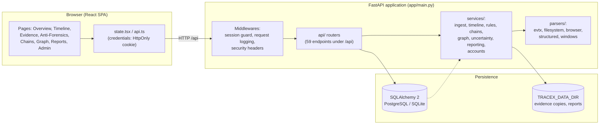
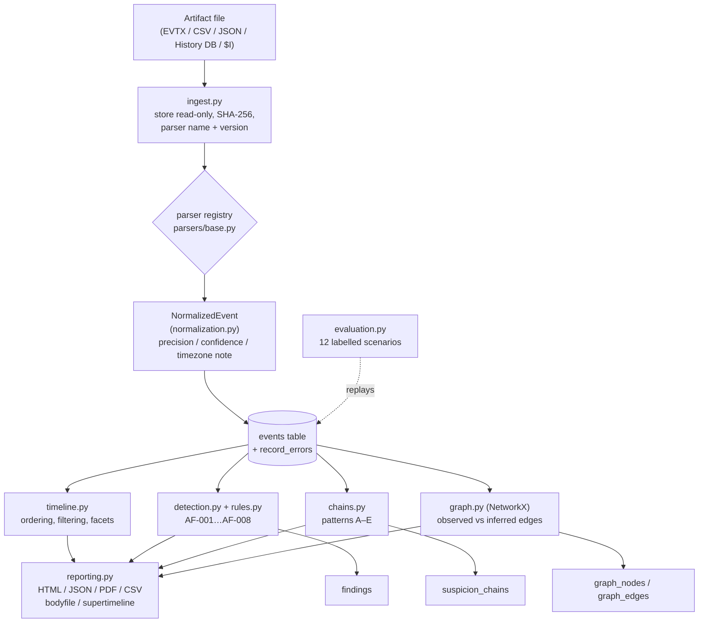
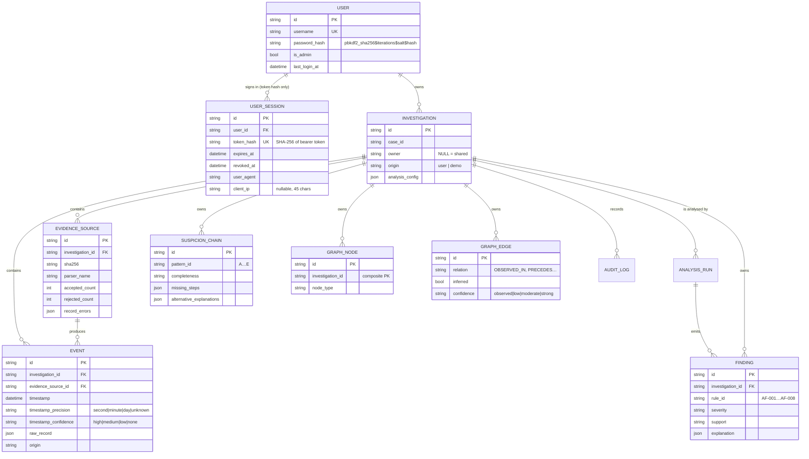

# TRACE-X: An Explainable Digital Forensics Engine

**Project Report**

| | |
|---|---|
| Submitted by | [INSERT: author name(s)] |
| Program / Department | [INSERT: department or program] |
| Institution | [INSERT: university / college name] |
| Academic year / Semester | [INSERT: year and semester] |
| Guide / Examiner | [INSERT: name, if applicable] |
| Purpose of report | [INSERT: college capstone / course project / hackathon / internship] |
| Audience | [INSERT: professor / evaluators / judges] |

---

## 1. Title Page and Abstract

Digital forensics investigations require reconstructing a defensible chronology from
heterogeneous artifacts — Windows event logs, filesystem metadata, browser history and
structured exports — and communicating conclusions without overstating what the recovered
records prove. TRACE-X is a self-hosted forensics engine that addresses this problem with an
explicit three-layer analytical contract: *evidence* (what an artifact directly records),
*correlation* (how observations relate in time or context) and *hypothesis* (what a sequence
might indicate, with uncertainty and alternatives stated). The system ingests artifacts
through a versioned parser registry, normalizes them into a unified event model that carries
timestamp precision and confidence, persists them in a relational store, and derives
timeline, rule-based anti-forensics findings, suspicion chains and a correlation graph. Eight
conservative detection rules (AF-001 to AF-008) skip themselves when their required evidence
is absent, and every finding declares what it does not establish. A controlled evaluation
harness replays labelled synthetic scenarios under three configurations to measure the
contribution of each analytical layer. The implementation comprises a FastAPI backend, a
React front end, an automated test suite and a CI pipeline. Findings, reports and exports are
generated exclusively from persisted rows, so every claim is traceable to a source record.

*(Word count of abstract: [INSERT: recount after edits]; target 150–200 words.)*

---

## 2. Introduction

### 2.1 Problem statement

An investigator who acquires a disk image or a set of log exports must answer three
questions: *what happened*, *in what order*, and *how strongly does the evidence support each
conclusion*. Existing workflows frequently collapse these questions. Timelines are assembled
from raw tool output whose timestamps have differing precision and timezone semantics;
correlations between two records are presented as if they were causal; and the absence of a
record — which may simply reflect incomplete collection — is read as proof of deletion. The
repository's own README states this policy directly: *"Correlation is never presented as
causation; missing records are reported as missing coverage, not as proven deletion"*
([README.md](README.md)).

A second problem is auditability. When a finding is reported, the analyst must be able to
trace it back to the exact artifact row that produced it. Ad-hoc scripts make this difficult
because intermediate results are rarely retained with their provenance.

### 2.2 Motivation

The motivation for TRACE-X is the gap between *raw forensic output* and *defensible,
explainable reporting*. The project is organised around the observation that most forensic
reasoning errors are not parsing errors but interpretation errors: an engine that ingests a
file correctly can still mislead its user if it presents a temporal association as a proven
mechanism, or an absent log line as proof of tampering. The design therefore treats the
statement of uncertainty as a first-class output rather than a footnote.

### 2.3 Objectives

The objectives, as implemented in the repository, are:

1. **Artifact ingestion with provenance.** Import Windows EVTX, filesystem metadata
   (FSAT/CSV/JSON, NTFS-style `$MFT` and USN exports), Chromium `History` databases, Recycle
   Bin `$I` records and structured JSON/CSV, storing the SHA-256 of the exact bytes, parser
   name/version, per-row rejection reasons and an audit entry for each import.
2. **Timeline reconstruction.** Normalise records into a single event model that carries
   timestamp precision (`second|minute|hour|day|unknown`), confidence
   (`high|medium|low|none`) and timezone notes, and order them without pretending that
   date-only values are second-precise.
3. **Explainable anti-forensics detection.** Apply a curated ruleset (AF-001…AF-008) in which
   each rule declares its required evidence, is skipped with a machine-readable reason when
   that evidence is absent, and emits an explanation containing alternatives and limitations.
4. **Correlation.** Build suspicion chains (patterns A–E) and an entity/event graph that
   distinguishes observed relationships from inferred ones.
5. **Reproducible reporting.** Produce HTML, JSON, PDF, CSV and interoperable
   (bodyfile/super-timeline) exports generated only from persisted rows.
6. **Evaluation.** Replay labelled synthetic scenarios under three configurations
   (timeline only; + rules; + graph and uncertainty reasoning) to measure each layer's
   contribution against declared ground truth.
7. **Multi-user operation and governance.** Provide user accounts with PBKDF2 password
   hashing, HttpOnly session cookies, investigation ownership, an audit trail and an admin
   section for registered users and session revocation.

### 2.4 Scope

The scope covers the ingestion of the artifact classes listed above, offline analysis of
imported data, and report generation. It does **not** include disk imaging or acquisition,
live response agents, mobile-device extraction, or network capture analysis; the input to
TRACE-X is always an already-acquired artifact. The system runs on a trusted local machine or
a self-hosted deployment; it does not provide TLS termination, rate limiting or key rotation
(see Section 9).

---

## 3. Literature Review / Existing Solutions

*Note: this section describes categories of existing work. Claims that could not be
verified against a citable source within this repository are explicitly marked
**[needs citation]**.*

### 3.1 Timeline and super-timeline tooling

The established open-source approach to timeline construction is the *super-timeline*
workflow of **plaso / log2timeline**, which aggregates many artifact types into a single
timeline file consumed by **psort.py** for sorting and analysis, and the classic
**mactime** bodyfile workflow from The Sleuth Kit. TRACE-X does not replace these tools; it
produces outputs intended to be consumed by them — a TSK bodyfile(5) CSV
(`GET /investigations/{id}/export/bodyfile.csv`) and a plaso-style super-timeline CSV
(`GET /investigations/{id}/export/supertimeline.csv`), as documented in the README export
table and implemented in `backend/app/api/data.py`. The performance characteristics and
feature set of plaso and mactime are **[needs citation]**.

### 3.2 Commercial forensic suites

Commercial suites (e.g., EnCase, FTK, Cellebrite) offer integrated acquisition, processing
and reporting. Their internals are largely proprietary, so no verifiable technical comparison
is possible from this repository; all comparative statements about them are **[needs
citation]**. The differentiating claim of TRACE-X is not coverage but *presentation*: an
explicit evidence/correlation/hypothesis separation enforced by the report generator
(`backend/app/services/reporting.py`).

### 3.3 Anti-forensics detection

Anti-forensics — log clearing, artifact deletion, timestamp manipulation, timestomping — is a
long-studied subject, and rule-based detectors for these techniques are described in the
forensics literature **[needs citation]**. TRACE-X's contribution in this report is limited
to what the code demonstrates: eight rules whose metadata (required evidence, conditions,
exclusions, severity, explanation template, limitations, version) is declared in
`backend/app/services/rules.py`, executed by `backend/app/services/detection.py`, with the
property that a rule lacking its required evidence is skipped rather than silently passing.

### 3.4 Explainability and calibrated uncertainty

Approaches that express forensic conclusions as numeric probabilities require calibration
studies to be meaningful. TRACE-X deliberately reports *qualitative* support levels and keeps
concepts separate rather than merging them into a single score; this rationale is documented
in `backend/app/services/uncertainty.py`. The broader literature on calibrated probabilistic
reporting and on explainable decision support is **[needs citation]**.

### 3.5 Summary of positioning

| Approach | Representative system(s) | TRACE-X relationship |
|---|---|---|
| Super-timeline aggregation | plaso / log2timeline, mactime **[needs citation for feature claims]** | Interoperable: TRACE-X *exports* bodyfile and plaso-style CSV |
| Integrated commercial suites | EnCase, FTK, Cellebrite **[needs citation]** | Not compared technically (proprietary internals) |
| Anti-forensics detection | Research detectors **[needs citation]** | In-repo implementation: rules AF-001…AF-008 with skip semantics |
| Uncertainty reporting | Calibrated probability methods **[needs citation]** | Contrasted: qualitative support levels, no pseudo-probabilities |

*Table 1: Positioning of TRACE-X relative to existing solution categories. All entries
marked **[needs citation]** require an external reference before submission.*

---

## 4. System Requirements

### 4.1 Functional requirements

| ID | Requirement | Evidence in repository |
|---|---|---|
| FR1 | Create, update, delete and list investigations with ownership | `backend/app/api/investigations.py` |
| FR2 | Import evidence artifacts; preview before import; batch import with per-file failure isolation | `POST /evidence`, `/evidence/preview`, `/evidence/batch` |
| FR3 | Hash stored artifacts (SHA-256) and re-verify them on demand | `POST /evidence/{source_id}/verify` |
| FR4 | Report rejected rows with machine-readable reasons instead of dropping them | `EvidenceSource.record_errors`, `GET /evidence/{id}/errors` |
| FR5 | Reconstruct a filterable, exportable timeline with uncertainty metadata | `app/services/timeline.py`, `GET /timeline/export` |
| FR6 | Run analysis and persist findings, chains and graph | `POST /analysis/run`, `app/services/*.py` |
| FR7 | Generate reports and exports from persisted rows only | `app/services/reporting.py` |
| FR8 | Provide demo/synthetic data clearly labelled as such | `app/demo.py`, `origin == "demo"` |
| FR9 | Sign-up / sign-in / sign-out with HttpOnly session cookies | `app/api/accounts.py`, `app/services/accounts.py` |
| FR10 | Admin listing of registered users and per-session / per-user revocation | `backend/app/api/admin.py` |
| FR11 | Optional API-key auth for scripted access, with constant-time comparison | `app/auth.py`, `TRACEX_AUTH_ENABLED` |
| FR12 | Evaluation harness over labelled scenarios with ground truth | `app/evaluation.py`, `app/datasets.py` |

*Table 2: Functional requirements and their implementation locations.*

### 4.2 Non-functional requirements

- **Traceability.** Every event retains `raw_record` / `raw_record_reference`, parser name
  and version, and an integrity hash (`models.py`).
- **Integrity.** Stored evidence is treated as immutable; re-hashing detects later
  modification of the stored copy.
- **Isolation.** All investigation-owned rows cascade from the investigation; the API applies
  an ownership guard to every router carrying an investigation id
  (`backend/app/api/__init__.py`).
- **Honesty of output.** Findings carry a three-layer explanation contract; the evaluation
  harness reports null precision instead of a misleading value when no positive prediction
  was made (`docs/evaluation-results.md`).
- **Portability.** Runs on SQLite with zero infrastructure; switches to PostgreSQL through
  environment variables (`backend/app/config.py`).
- **Security hygiene.** No `eval`/`exec`/`subprocess`/`pickle` in application code, restrictive
  CSP on HTML reports, `X-Content-Type-Options: nosniff` on every response, schema validation
  of all user-supplied values (README "Security hardening", regression-tested in
  `backend/tests/test_integrity_and_report.py`).

### 4.3 Hardware requirements

| Component | Minimum (development) | Recommended (classroom demo / small team) |
|---|---|---|
| CPU | 2 cores | 4+ cores |
| RAM | 4 GB | 8 GB+ |
| Storage | ~1 GB for application and sample datasets | 10 GB+ for imported evidence copies |
| Network | None (localhost operation) | LAN only; TLS terminated externally if exposed |

*Table 3: Hardware requirements. Workload-dependent figures such as maximum events per import
are not measured in this repository — [INSERT RESULT: ingestion throughput on target hardware].*

### 4.4 Software requirements

| Layer | Requirement | Source of truth |
|---|---|---|
| Runtime | Python (CI runs 3.12; the development environment uses a Python 3.14 virtual environment) | `.github/workflows/ci.yml`, `.venv` |
| Web framework | FastAPI 0.143.3, Uvicorn 0.54.0 | `backend/requirements.txt` |
| Persistence | SQLAlchemy 2.1.5; PostgreSQL 18 (Alembic 1.20.0) or SQLite fallback | `backend/requirements.txt`, `docker-compose.yml` |
| Graph analysis | NetworkX ≥ 3.0 | `backend/requirements.txt` |
| EVTX parsing | python-evtx 0.8.1 | `backend/requirements.txt` |
| Schema | Pydantic 2.14.1 | `backend/requirements.txt` |
| Front end | Node.js 22 (CI), React 18.3, TypeScript 5.6, Vite 5 | `.github/workflows/ci.yml`, `frontend/package.json` |
| Tests | pytest 9.1.1, httpx 0.28.1, Jest 29.7 + ts-jest | `backend/requirements.txt`, `frontend/package.json` |
| Browser | Any Chromium-based or modern browser serving `frontend/dist` | README |

*Table 4: Software requirements verified against dependency and CI files.*

---

## 5. System Architecture and Design

### 5.1 Architectural overview

TRACE-X uses a two-tier client–server architecture: a React single-page application served
either by the Vite development server or by the FastAPI process itself (which mounts
`frontend/dist` when present), and a FastAPI JSON API that owns all persistence and analysis.
All analytical computation occurs server-side; the browser renders values returned by the API
and never computes findings itself.



**Figure 1: System architecture.** The browser holds no analytical logic; the session guard
in `app/main.py` admits only authenticated requests to the API routers.

### 5.2 Data flow



**Figure 2: Data flow from artifact import to report.** Rejected rows are retained alongside
accepted events; nothing is silently discarded.

### 5.3 Entity-relationship design



**Figure 3: Entity-relationship diagram** derived from `backend/app/models.py`. Every
investigation-owned table cascades from `investigations`; there are no cross-investigation
foreign keys.

### 5.4 Technology stack and rationale

| Choice | Reason recorded in the project |
|---|---|
| **FastAPI + Pydantic** | Schema validation is part of the security model: invalid input is rejected with structured 422 errors (`main.py` validation handler) rather than handled ad hoc. |
| **SQLAlchemy 2 (typed `Mapped` columns)** | Declarative, portable ORM allowing the same models to run on PostgreSQL (production) and SQLite (zero-infrastructure development). |
| **Alembic** | Controlled schema evolution for PostgreSQL; the SQLite development path is synchronised via `create_all` (README "Deployment"). |
| **NetworkX** | Graph construction and path/isolation queries server-side (`app/services/graph.py`), served to the browser as Cytoscape.js elements. |
| **Cytoscape.js (+ dagre layout)** | Client-side rendering of the forensic graph with layout algorithms, without moving graph computation into the browser (`frontend/package.json`). |
| **React + TypeScript + Vite** | Typed single-page front end with fast builds; `tsc --noEmit` runs as part of `npm run build`, so type errors fail the build. |
| **python-evtx** | Avoids re-implementing the EVTX binary format; the parser sits behind the shared `BaseParser` interface so a missing dependency fails loudly instead of fabricating records (README "Known limitations"). |
| **Pydantic secrets-free config** | All credentials come from environment variables; `config.py` stores no keys (README "Environment configuration"). |

*Table 5: Technology choices and the justification each one has in the repository.*

---

## 6. Implementation

This section explains the system module by module. Line references and snippets are taken
from the current repository state; the backend `app/` package contains 33 Python files
(10,938 lines) and the front end contains 19 TypeScript/TSX files (5,095 lines).

### 6.1 Application entry point and middleware — `backend/app/main.py`

The FastAPI application is assembled with a lifespan hook that creates directories and
initialises the database before serving:

```python
@asynccontextmanager
async def lifespan(_: FastAPI):
    ensure_directories()
    init_db()
    logger.info("TRACE-X engine %s (ruleset %s) ready; env=%s", ENGINE_VERSION,
                RULES_VERSION, APP_ENV)
    yield
```

Three concerns are implemented as HTTP middleware. The **session guard** enforces user
authentication: every `/api` request outside the public auth paths must carry a live session,
resolved once and exposed as `request.state.user`:

```python
token = _extract_token(request)
user = None
if token:
    db = SessionLocal()
    try:
        user = resolve_session(db, token)
    finally:
        db.close()
if user is None:
    if config.AUTH_ENABLED and token and _match_api_key(token):
        return await call_next(request)
    return JSONResponse(status_code=401, content={"detail": {
        "code": "auth_required",
        "message": "your session has expired or is invalid — sign in again"}})
request.state.user = user
```

The **request-logging middleware** measures duration, sets `X-TRACE-X-Engine` and
`X-Content-Type-Options: nosniff` on every response, and deliberately excludes high-frequency
`/activity` and `/events` paths from logging. Structured **exception handlers** convert
validation failures and unhandled errors into machine-readable JSON bodies
(`{"error": {"code": "validation_error", …}}`). If `frontend/dist` exists it is mounted at
`/`, allowing a single process to serve the whole application.

### 6.2 Configuration — `backend/app/config.py`

All behaviour is environment-driven: database URL (explicit `DATABASE_URL`, else
`POSTGRES_*`, else a local SQLite file), API prefix, auth flags, session lifetime
(`TRACEX_SESSION_HOURS`, default 24), HttpOnly cookie name (`TRACEX_SESSION_COOKIE`, default
`tracex_session`), admin usernames, login throttle (5 attempts / 300 s), and the PBKDF2 work
factor (390,000 iterations by default). Analysis defaults — chain window, mass-deletion
threshold, logging-gap and clock-drift thresholds, graph node cap — are declared once as
`DEFAULT_ANALYSIS_CONFIG` and can be overridden per investigation.

```python
USER_AUTH_ENABLED = os.environ.get("TRACEX_USER_AUTH_ENABLED", "true").lower() == "true"
SESSION_HOURS = int(os.environ.get("TRACEX_SESSION_HOURS", "24"))
SESSION_COOKIE_NAME = os.environ.get("TRACEX_SESSION_COOKIE", "tracex_session")
PASSWORD_PBKDF2_ITERATIONS = int(os.environ.get("TRACEX_PBKDF2_ITERATIONS", "390000"))
ENGINE_VERSION = "1.0.0"
RULES_VERSION = "1.0.0"
```

### 6.3 Data model — `backend/app/models.py`

Eleven tables implement the design of Figure 3. Three invariants are documented at the top
of the module: evidence sources are immutable after ingestion, raw source data is kept
separately from normalised fields, and no cross-investigation foreign keys exist. The event
model carries uncertainty explicitly:

```python
timestamp_precision: Mapped[str] = mapped_column(String(24), default="unknown")
timestamp_confidence: Mapped[str] = mapped_column(String(24), default="none")
timezone_note: Mapped[str | None] = mapped_column(String(255), nullable=True)
…
raw_record: Mapped[dict | None] = mapped_column(JSON, nullable=True)
raw_record_reference: Mapped[str | None] = mapped_column(String(255), nullable=True)
```

Composite indexes support the timeline access path (`ix_events_investigation_ts`,
`ix_events_investigation_type_ts`). `GraphNode`/`GraphEdge` use a composite primary key of
`(id, investigation_id)` because deterministic node ids such as `file:<hash>` recur across
investigations. Schema evolution is managed by five Alembic revisions:

| Revision | Change |
|---|---|
| `0989628cf3b0` | initial schema |
| `b7d21f4a9c32` | investigation owner column + performance indexes |
| `d4a1e8b6c93f` | `users` and `user_sessions` tables |
| `f8c3a21d7e45` | `users.is_admin` |
| `a7d5e1c9b402` | `user_sessions.client_ip` |

*Table 6: Migration chain (`down_revision` links verified in `backend/alembic/versions/`).*

### 6.4 Parser framework — `backend/app/parsers/`

`base.py` defines the registry: each parser declares `name`, `version`, the `source_type` it
produces, the `file_type` it accepts, and exposes `parse(path) -> ParseResult`, where the
result carries accepted events **and** row-level errors:

```python
# parsers/base.py
# `ParseResult` carries accepted events *and* row-level errors: invalid records
# are reported, never silently discarded.
```

| Parser file | Handles | Notes from code |
|---|---|---|
| `evtx.py` | Windows Event Log (`.evtx`) | Uses `python-evtx`, parses each record's XML rendering; SYSTEMTIME treated as UTC |
| `filesystem.py` | FSAT-style CSV/JSON, `$MFT`-like and USN records | "A file copy is NEVER confirmed from timestamps alone" |
| `browser.py` | Chromium `History` (SQLite `urls` + `visits`) | Chromium epoch converted to UTC; recorded as evidence of recorded activity only |
| `structured.py` | Normalised JSON/CSV import | Every rejected row returned with index, reason and raw excerpt |
| `windows.py` | Recycle Bin `$I` (binary FILETIME), `$MFT`/Prefetch/ShimCache/UserAssist export adapters | Adapters normalise third-party tools' output and record that provenance |

*Table 7: Parser registry contents.*

### 6.5 Normalisation and ingestion — `normalization.py`, `services/ingest.py`

`NormalizedEvent` is the contract between parsers and storage. Its governing rules are
stated in the module docstring: *"never fabricate a value the source does not provide — leave
it None"* and *"keep the original timestamp string next to the normalized one"*. The
ingestion service stores the artifact read-only at a content-addressed path, computes its
SHA-256, dispatches to the correct parser, persists normalised events, retains rejection
detail and records provenance (parser name/version, import metadata).

### 6.6 Timeline engine — `services/timeline.py`

The timeline module implements filtering, ordering and export. Ordering is uncertainty-aware:
date-only timestamps are not interleaved as if second-precise (precision and confidence are
stored per event and surfaced by the API facets endpoint). The API layer exposes filtered
paged reads (`GET /investigations/{id}/events`), facets for the filter UI, single-event
detail with its raw record, and a CSV/JSON export that reflects the active UI filters.

### 6.7 Detection rules — `services/rules.py`, `services/detection.py`

`rules.py` (1,089 lines) defines the v1 ruleset AF-001…AF-008:

| ID | Rule (title in code) |
|---|---|
| AF-001 | Audit log clearing (observed directly) |
| AF-002 | Suspicious deletion of forensic-relevant artifacts |
| AF-003 | Mass deletion pattern |
| AF-004 | Timestamp inconsistencies |
| AF-005 | Relevant activity followed by evidence loss |
| AF-006 | Suspicious gaps in expected logging |
| AF-007 | Modification of forensic-relevant artifacts |
| AF-008 | Suspicious execution followed by log clearing |

*Table 8: Detection ruleset (rule identifiers and titles as declared in `rules.py`).*

The module documents the discipline each rule follows: it declares the evidence it needs and
is skipped when that evidence is absent; a missing record is reported as missing evidence,
never as proof of tampering; and every finding states what it does *not* establish together
with plausible benign explanations. `detection.py` executes rule metadata — required
evidence, conditions, exclusions, severity, explanation template, limitations, version — and
produces findings with a qualitative `support` level and score components retained for
explanation.

### 6.8 Suspicion chains — `services/chains.py`

Five patterns (A–E) are defined as candidate sequences, not verdicts; each chain carries
missing steps, alternative explanations and the rules it triggered:

| Pattern | Name |
|---|---|
| A | Sensitive access → possible copy → deletion |
| B | Suspicious execution → audit log clearing |
| C | Metadata modification → timestamp inconsistency |
| D | Relevant activity → loss of supporting evidence |
| E | File access → removable media → evidence anomaly |

*Table 9: Suspicion-chain patterns (`app/services/chains.py`).* Incomplete patterns are still
reported, annotated with which evidence is missing.

### 6.9 Correlation graph — `services/graph.py`

The graph is built server-side with NetworkX and served to Cytoscape.js. Node types are
`event, file, user, process, device, evidence_source, finding, hypothesis`; relationship
types are `OBSERVED_IN, ASSOCIATED_WITH, SAME_USER, SAME_PROCESS, SAME_FILE, TEMPORALLY_NEAR,
PRECEDES, SUPPORTS, CONTRADICTS, POSSIBLY_CAUSAL`. Observed and inferred edges are
distinguished by the `inferred` flag and a confidence of `observed|low|moderate|strong`. The
endpoint set includes subgraph retrieval, graph actions, path queries and connected-component
isolation, with a configurable node cap (`graph_max_nodes`, default 600) to bound the
browser's rendering load.

### 6.10 Uncertainty methodology — `services/uncertainty.py`

The module states that TRACE-X reports *qualitative* support levels and deliberately does not
present arbitrary percentages as calibrated probabilities; the concepts it keeps separate are
never merged into one number. The `/api/uncertainty` endpoint exposes this methodology to the
UI so the legend shown to analysts comes from the same source as the analysis.

### 6.11 Reporting — `services/reporting.py`

Report generation (768 lines) produces the print-optimised HTML report, machine-readable JSON,
a self-contained PDF, findings CSV, events JSON, TSK bodyfile CSV and plaso-style
super-timeline CSV — always from persisted rows. The report structure enforces the three
layers (evidence → correlation → hypothesis) and appends limitations and the audit trail. The
HTML report ships a restrictive `Content-Security-Policy` (`default-src 'none';
style-src 'unsafe-inline'`) because it contains no scripts, images or iframes.

### 6.12 Accounts, sessions and administration — `services/accounts.py`, `api/accounts.py`, `api/admin.py`

Passwords are stored as PBKDF2-HMAC-SHA256 with a per-password random salt; the work factor
is embedded in the hash string so it can be raised later without invalidating accounts.
Sessions are issued as an **HttpOnly, SameSite=Lax** cookie: the raw token never appears in a
response body, and the database stores only its SHA-256 digest, so a database copy cannot be
replayed. Login is throttled in-process (5 failed attempts → 300 s lockout by default). The
first registered account becomes the instance administrator, as does any name listed in
`TRACEX_ADMIN_USERS`. Administrators get four endpoints — list users, list a user's sessions,
revoke one session, revoke all of a user's sessions — enforced server-side
(`backend/app/api/admin.py`), and the admin session rows show the device user agent and the
client IP captured at sign-in (stored in `user_sessions.client_ip`, added by migration
`a7d5e1c9b402`).

### 6.13 API layer — `backend/app/api/`

59 endpoints are registered under the `/api` prefix across six routers. A single
`ownership_guard` dependency is attached to the investigation, analysis and data routers so
that every route carrying an investigation id is ownership-gated uniformly
(`backend/app/api/__init__.py`):

```python
_guard = [Depends(ownership_guard)]
api_router.include_router(accounts_router)
api_router.include_router(admin_router)
api_router.include_router(auth_router)
api_router.include_router(investigations_router, dependencies=_guard)
api_router.include_router(analysis_router, dependencies=_guard)
api_router.include_router(data_router, dependencies=_guard)
```

A complete endpoint listing appears in Appendix C.

### 6.14 Evaluation harness — `evaluation.py`, `datasets.py`

The harness replays controlled synthetic scenarios in throwaway in-memory databases under
three configurations — **A** timeline only, **B** + detection rules, **C** + graph correlation
and uncertainty-aware reasoning — computing micro-averaged precision, recall, false-positive
rate, chain metrics, event-order accuracy and processing time against ground truth declared
next to each scenario (`expected_rules`, `expected_chains`, ground-truth sort). The module
docstring and the recorded results emphasise that numbers are computed, never hardcoded, and
that limitations (such as a null precision when no positive prediction is made) are reported
alongside them.

### 6.15 Front end — `frontend/src/`

| Module | Role |
|---|---|
| `main.tsx` / `App.tsx` | Bootstraps React Router with ten routes (`/`, `/investigations`, `/timeline`, `/evidence`, `/anti-forensics`, `/chains`, `/graph`, `/reports`, `/admin`, `/settings`) and a catch-all redirect |
| `api.ts` | Typed fetch wrapper for the API; credentials ride on the HttpOnly cookie (no token in JavaScript) |
| `state.tsx` | Application context: active investigation, asynchronous data hooks, toasts |
| `components/Layout.tsx` | Navigation shell, active-case selector, session-aware chrome |
| `components/ui.tsx` | Shared primitives: `StatCard`, `Distribution`, `ActivityChart`, `SeverityBadge`, `SupportBadge`, `Modal`, `Drawer`, `Skeleton`, `EmptyState` |
| `pages/*.tsx` | Ten page components, one per route plus `Login` |
| `types.ts` | TypeScript mirrors of the API payloads, including `AdminSession.client_ip` |
| `__tests__/fmtTs.test.ts` | Jest tests for timestamp formatting |

*Table 10: Front-end module map.* Charts render only values returned by the API — the
`Distribution` and `ActivityChart` components take count maps and bucket counts as props, so
the UI cannot originate data.

```tsx
// frontend/src/components/ui.tsx
/** Horizontal distribution bars computed from a count map. */
export const Distribution: React.FC<{ data: Record<string, number>; … }> = ({ data, … }) => {
  const entries = Object.entries(data || {}).sort((a, b) => b[1] - a[1]);
  …
};
```

### 6.16 Demonstration data — `demo.py`

Demo generation creates investigations, sources and events that all carry `origin == "demo"`
and are rendered with a synthetic badge, so demonstration data is never mixed with imported
evidence unlabelled.

---

## 7. Testing and Results

### 7.1 Test approach

Testing is stratified into four layers, each with an independent entry point:

1. **Backend automated suite** — `pytest tests/` against SQLite, using shared fixtures in
   `backend/tests/conftest.py`. The suite covers parsers and invalid-row reporting, timeline
   ordering/filtering/search, uncertain timestamps, detection rules and three-layer
   explanations, suspicion chains, graph integrity, investigation isolation, evidence
   hashing, report/manifest generation, demo labelling, API-key auth and ownership, batch
   evidence import, integrity re-verification, bodyfile/super-timeline/PDF exports and API
   validation (README "Testing").
2. **PostgreSQL integration suite** — `pytest -m pg`, marked and deselected by default,
   requiring a live server (`TRACEX_TEST_PG_URL`). It covers the full Alembic chain on a
   fresh database, `alembic check` drift detection, ingest→analysis→timeline round-trip,
   `timestamptz` round-trip, `date_trunc` grouping and owner filtering.
3. **Front end** — `tsc --noEmit` (run as the first step of `npm run build`) plus Jest unit
   tests for pure functions.
4. **End-to-end smoke test** — `scripts/smoke_test.sh`, a curl-based acceptance path against
   a running API: health → create investigation → validation-rejection check → evidence
   preview and import → records/errors → timeline → analysis → findings → chains → graph →
   uncertainty → report → exports → isolation check.

Continuous integration (`.github/workflows/ci.yml`) runs three jobs on every push and pull
request: the SQLite suite (`pytest -q -m "not pg"`), the PostgreSQL 18 integration suite
(`pytest -q -m pg`, including `alembic check`), and the front-end typecheck/build.

### 7.2 Test modules

| Test module | Primary coverage |
|---|---|
| `tests/test_parsing.py` | Parser outputs and per-row rejection reporting |
| `tests/test_timeline.py` | Ordering, filtering, search, uncertain timestamps |
| `tests/test_detection.py` | Rules AF-001…AF-008, three-layer explanations |
| `tests/test_feature_batch.py` | Batch import, integrity re-verification, exports |
| `tests/test_graph_and_isolation.py` | Graph integrity, cross-investigation isolation |
| `tests/test_integrity_and_report.py` | Evidence hashing, report/manifest, header-injection regression |
| `tests/test_accounts.py` | Signup, sign-in, sessions, HttpOnly cookie, throttling |
| `tests/test_admin.py` | Admin user listing and session revocation |
| `tests/test_postgres_integration.py` | Live-PostgreSQL suite (marker `pg`) |
| `frontend/src/__tests__/fmtTs.test.ts` | Timestamp formatting in the UI |

*Table 11: Test modules and their coverage areas.*

### 7.3 Executed results

All figures below were produced by commands run against the current working tree; exit codes
were captured directly.

| Check | Command | Result | Exit code |
|---|---|---|---|
| Backend suite (default) | `pytest tests/ -q -m "not pg"` | **114 passed, 1 skipped, 6 deselected**, 1 warning, 21.41 s | 0 |
| Test collection | `pytest --collect-only -q` | **121 tests collected** | 0 |
| Front-end unit tests | `npm test` (Jest) | **6 passed, 1 suite**, 0.775 s | 0 |
| Front-end type check | `npx tsc --noEmit` | no errors | 0 |
| Front-end production build | `npm run build` | built in 6.82 s → `index-DgT3bX-e.js` (813.47 kB, 251.67 kB gzip), `index-DSanFapD.css` (16.61 kB) | 0 |
| PostgreSQL integration | `pytest -q -m pg` | not executed on this machine (no configured server) | not run |
| End-to-end smoke test | `bash scripts/smoke_test.sh` | not executed in this report's run | not run |

*Table 12: Verification results executed while preparing this report.* The single skipped
test is intentional: it asserts behaviour for a deliberately incomplete detection scenario
that the current ruleset does not define (`tests/test_detection.py`, skip reason "no
deliberately incomplete scenario in this ruleset").

### 7.4 Evaluation results

The controlled evaluation replayed eleven labelled scenarios (79 ingested events) under the
three configurations described in Section 6.14. The table below reproduces the recorded
output of the run documented in `docs/evaluation-results.md` (generated 2026-10-18T10:48:29Z,
engine 1.0.0, ruleset 1.0.0, no errors, ≈1.9 s wall time for 33 scenario-configurations):

| Metric | A (timeline) | B (+ rules) | C (+ graph/reasoning) |
|---|---|---|---|
| Rule TP / FP / FN / TN | 0 / 0 / 21 / 67 | 21 / 0 / 0 / 67 | 21 / 0 / 0 / 67 |
| Rule precision | null (0/0 undefined) | 1.0 | 1.0 |
| Rule recall | 0.0 | 1.0 | 1.0 |
| Rule false-positive rate | 0.0 | 0.0 | 0.0 |
| Chain TP / FP / FN / TN | 0 / 0 / 8 / 47 | not built | 8 / 0 / 0 / 47 |
| Chain precision | null | null | 1.0 |
| Chain recall | 0.0 | 0.0 | 1.0 |
| Event-order accuracy | 1.0 | 1.0 | 1.0 |
| Relationship accuracy | n/a | n/a | 1.0 |
| Explainability coverage | n/a | 1.0 | 1.0 |
| Mean analysis time | n/a | 7 ms | 18 ms |
| Mean wall time per scenario | 31 ms | 67 ms | 47 ms |

*Table 13: Recorded A/B/C evaluation output (`docs/evaluation-results.md`, run of
2026-10-18).* These numbers are generated live by `POST /api/evaluation/run`; they are not
hardcoded in the harness or the UI.

**Interpretation and caveats, as stated by the project itself.** The dataset is synthetic
and authored by the same project, so the numbers measure consistency with declared ground
truth, not real-world validity; eleven small scenarios cannot represent casework diversity;
no independently labelled corpus or inter-rater agreement was used; and timings are
wall-clock measurements on one developer machine intended for regression comparison. The
project's own documentation therefore characterises this as a regression baseline rather
than a published benchmark. Reproducing the run:

```bash
cd backend && ../.venv/Scripts/python -m app.evaluation
```

### 7.5 Interface walkthrough (screenshots)

The captures below were taken from a running TRACE-X instance seeded with the repository's
sample artifacts (`datasets/`) in an isolated development database. Every value visible in
them is computed by the API from persisted rows; the case shown is `CAPSTONE-2026-01`.


**Figure 4: Overview page** — stat cards, hourly activity chart, graph preview and per-rule indicator distribution, all computed from persisted rows.


**Figure 5: Evidence Explorer** — a selected source detail showing SHA-256, parser and version, integrity note, record counts and the normalized events it produced.


**Figure 6: Timeline with the filter panel open** — facet filters, ordering control and events carrying uncertainty flags.


**Figure 7: Explainable finding detail** — the three layers (evidence, correlation, hypothesis), what the finding does not establish, and its alternative explanations.


**Figure 8: Suspicion chain detail** — ordered sequence with anchor and linked steps, triggered rules and alternative explanations.


**Figure 9: Correlation graph** — Cytoscape.js rendering with node/relationship filters, graph statistics and the observed/inferred legend.


**Figure 10: Generated investigation report** — case information, investigation scope and evidence sources with SHA-256 integrity hashes.


**Figure 11: Admin session management** — registered users with the expanded session list showing device (user agent), client IP, expiry and per-session revocation.


**Figure 12: Evaluation harness output** — the A/B/C comparison table with confusion totals and the metric methodology.

---

## 8. Challenges and Solutions

The following challenges are documented in the repository together with the solution adopted
in code; each entry is traceable to the file cited.

| # | Challenge | Solution implemented | Evidence |
|---|---|---|---|
| 1 | Timestamps arrive with mixed precision, timezones and clock quality | Per-event `timestamp_precision`, `timestamp_confidence` and `timezone_note`; date-only values are never ordered as second-precise | `models.py`, `normalization.py` |
| 2 | Anti-forensic rules fire on legitimate administrative activity | Rules declare required evidence and are skipped with a machine-readable reason when it is absent; benign "trap" scenarios are part of the evaluation ground truth | `services/rules.py`, `docs/evaluation-results.md` |
| 3 | Absence of a record is easily misread as proof of deletion | Findings state what they do *not* establish; missing records are reported as missing coverage | README policy, `reporting.py` |
| 4 | Correlation is easily presented as causation | Three-layer report structure; graph edges carry `inferred` and `confidence`; `POSSIBLY_CAUSAL` edges require a shared anchor | `reporting.py`, `services/graph.py` |
| 5 | Header injection / response splitting through user-supplied values | All user values schema-validated against control characters; `Content-Disposition` sanitised, with a regression test | `test_integrity_and_report.py`, README "Security hardening" |
| 6 | Session tokens exposed to page JavaScript | Sessions delivered only as an HttpOnly, SameSite=Lax cookie; database stores only the SHA-256 digest | `config.py`, `services/accounts.py` |
| 7 | Simultaneous support for zero-infrastructure SQLite and production PostgreSQL | Single URL resolver in config; Alembic as the controlled path for PostgreSQL, `create_all` for SQLite development | `config.py`, `alembic/versions/` |
| 8 | Legacy databases created before newer columns existed | Startup ensure-path adds pending columns to existing SQLite databases; migrations cover PostgreSQL | `db.py`, revisions `f8c3a21d7e45`, `a7d5e1c9b402` |
| 9 | Graph rendering load in the browser with large cases | Configurable `graph_max_nodes` cap (default 600) on the graph endpoint | `config.DEFAULT_ANALYSIS_CONFIG` |
| 10 | Cross-case data leakage between investigators | Uniform `ownership_guard` dependency on every investigation-bearing router; cascading delete-orphan relationships; isolation tests | `api/__init__.py`, `test_graph_and_isolation.py` |
| 11 | Evaluation numbers drifting or being hardcoded | Harness replays scenarios in throwaway in-memory databases; results regenerated live and mirrored with their limitations | `evaluation.py`, `docs/evaluation-results.md` |
| 12 | Duplicate findings across re-runs | `dedupe_key` columns on findings and chains | `models.py` |

*Table 14: Engineering challenges and the solutions present in the codebase.*

---

## 9. Limitations and Future Scope

### 9.1 Limitations

The repository states the following limitations explicitly (README "Known limitations");
they are reproduced here without softening:

1. **PostgreSQL integration tests run separately.** The default suite uses SQLite; the
   `pytest -m pg` suite requires a live server and could not be executed for this report
   because no server was configured in the environment used for these runs.
2. **Authentication is single-tenant in API-key mode.** Keys map to actor names with
   investigation-level ownership; there is no key-rotation UI, TLS termination or rate
   limiting. The README instructs that TRACE-X must not be exposed beyond localhost with
   API-key auth disabled.
3. **Docker images are untested on the development machine.** Docker is not installed in the
   development environment; the compose file is validated syntactically and exercised by CI,
   but the first `docker compose up` may surface platform-specific issues.
4. **EVTX parsing depends on `python-evtx`.** If the dependency is unavailable the import
   fails loudly rather than fabricating records.
5. **Timezone assumptions.** Timestamps without an offset are interpreted as UTC and flagged;
   naive local time and clock skew surface as uncertainty rather than being silently
   normalised.
6. **Curated ruleset.** AF-001…AF-008 is a starting set, not an exhaustive anti-forensics
   catalogue; false positives are expected, and every finding states its alternative
   explanations.
7. **Synthetic evaluation data.** The A/B/C numbers measure agreement with a self-declared
   ground truth on small scenarios — a regression baseline, not an external benchmark.
8. **One intentionally skipped test**, and one README test-count figure that no longer matches
   the collection count (see Open Questions).
9. **Client IP capture** uses the direct TCP peer address; a deployment behind a reverse proxy
   would require trusted `X-Forwarded-For` handling. Sessions created before the column was
   added display no client IP.

### 9.2 Future scope

The following are *proposed* extensions; none of them is implemented in the current
repository, and each would need to be validated against the existing architecture:

1. Wider artifact coverage (registry entries for additional Windows/Linux/macOS sources) by
   registering new parsers behind `BaseParser`.
2. Independent, externally labelled evaluation corpus with inter-rater agreement, replacing
   the self-authored synthetic ground truth.
3. Rate limiting, TLS guidance and API-key rotation tooling for non-localhost deployments.
4. Deeper plaso/mactime round-trip validation of the bodyfile and super-timeline exports.
5. [INSERT: additional future work items proposed by the team]

---

## 10. Conclusion

This report described TRACE-X, an explainable digital forensics engine implemented as a
FastAPI service and a React client. The system ingests heterogeneous forensic artifacts
through a versioned parser registry, normalises them into an uncertainty-aware event model,
and derives timelines, rule-based anti-forensics findings, suspicion chains and a correlation
graph — each output carrying the evidence, correlation and hypothesis layers that justify it.
Engineering concerns that usually erode trust in such tools — silent row loss, ambiguous
timestamps, findings without provenance, cross-case leakage and tokens readable by page
JavaScript — are addressed by explicit design decisions recorded in the code and enforced by
an automated suite of 121 collected tests (114 executed and passed in the run recorded in
Section 7.3), six front-end unit tests, type checking, continuous integration and an
end-to-end smoke script. A controlled three-configuration evaluation harness quantifies the
contribution of the detection and correlation layers while reporting its own limits. The
remaining limitations — chiefly the synthetic evaluation corpus and the curated ruleset —
are documented rather than hidden, consistent with the project's central claim that a
forensics tool must never state more than its evidence proves.

---

## 11. References

1. TRACE-X project repository — `README.md`, `docs/evaluation-results.md` (accessed
   October 2026). *[Internal source: cite the repository URL or submission portal here —
   INSERT: repository URL.]*
2. FastAPI documentation, https://fastapi.tiangolo.com/
3. SQLAlchemy 2.0 documentation, https://docs.sqlalchemy.org/en/20/
4. Alembic documentation, https://alembic.sqlalchemy.org/
5. Pydantic documentation, https://docs.pydantic.dev/
6. React documentation, https://react.dev/
7. TypeScript documentation, https://www.typescriptlang.org/docs/
8. Vite guide, https://vitejs.dev/guide/
9. NetworkX documentation, https://networkx.org/documentation/stable/
10. Cytoscape.js documentation, https://js.cytoscape.org/
11. W. Ballenthin, `python-evtx` — Windows Event Log parser,
    https://github.com/williballenthin/python-evtx
12. plaso — super-timeline framework (log2timeline), https://plaso.readthedocs.io/
13. The Sleuth Kit project, https://www.sleuthkit.org/ *[verify the exact citation for the
    mactime bodyfile(5) format before submission — INSERT: preferred citation]*
14. E. Zimmerman, MFTECmd, https://github.com/EricZimmerman/MFTECmd
15. NirSoft, WinPrefetchView, https://www.nirsoft.net/utils/win_prefetch_view.html
16. pytest documentation, https://docs.pytest.org/
17. NIST Special Publication 800-132, *Recommendation for Key Derivation Using
    Pseudorandom Functions*, https://nvlpubs.nist.gov/nistpubs/Legacy/SP/nistspecialpublication800-132.pdf
    *[verify URL before submission]*
18. GitHub Actions documentation, https://docs.github.com/en/actions

**[needs citation]** entries in Section 3 must be completed with sources for any comparative
claim retained in the final submission.

---

## 12. Appendix

### Appendix A: Setup and run instructions

Reproduced from `README.md`, `frontend/package.json` and `scripts/smoke_test.sh`:

```bash
# 1. Backend dependencies (project virtual environment at ./.venv)
python -m venv .venv
.venv/Scripts/pip install -r backend/requirements.txt

# 2. Run the API on 127.0.0.1:8000 (SQLite by default)
cd backend && ../.venv/Scripts/python -m uvicorn app.main:app --host 127.0.0.1 --port 8000

# 3. Front end (separate terminal): dev server on 127.0.0.1:5173, proxies /api to :8000
cd frontend && npm install && npm run dev

# 4. Open http://127.0.0.1:5173
```

```bash
# Tests
cd backend && ../.venv/Scripts/python -m pytest tests/ -q        # SQLite suite
cd backend && ../.venv/Scripts/python -m pytest -q -m pg          # live PostgreSQL suite
cd frontend && npm run build                                      # tsc --noEmit + vite build
cd frontend && npm test                                           # Jest
bash scripts/smoke_test.sh                                        # end-to-end (API on :8000)

# PostgreSQL deployment: run migrations once
cd backend && alembic upgrade head

# Full stack with Docker (requires Docker; .env with POSTGRES_PASSWORD)
docker compose up --build
```

Key environment variables (README "Environment configuration"): `DATABASE_URL`,
`POSTGRES_HOST/PORT/USER/PASSWORD/DB`, `TRACEX_DATA_DIR`, `TRACEX_AUTH_ENABLED`,
`TRACEX_API_KEYS`, `TRACEX_USER_AUTH_ENABLED`, `TRACEX_SESSION_HOURS`,
`TRACEX_SESSION_COOKIE`, `TRACEX_ADMIN_USERS`, `TRACEX_TEST_PG_URL`,
`TRACEX_TEST_PG_ADMIN_URL`. No secrets are stored in source.

### Appendix B: Directory tree

```text
TraceX/
├── README.md                     project overview, setup, security, limitations
├── docker-compose.yml            PostgreSQL 18 + backend + nginx-served frontend
├── .env.example                  environment template (no secrets)
├── .github/workflows/ci.yml      CI: SQLite suite, PG 18 integration, frontend build
├── backend/
│   ├── requirements.txt          pinned runtime + test dependencies
│   ├── app/
│   │   ├── main.py               FastAPI app, middlewares, exception handlers
│   │   ├── config.py             environment-driven configuration, version constants
│   │   ├── db.py                 engine/session, create_all, column-ensure path
│   │   ├── models.py             11 ORM tables
│   │   ├── schemas.py            Pydantic request/response models
│   │   ├── auth.py               API-key extraction and constant-time matching
│   │   ├── normalization.py      NormalizedEvent contract
│   │   ├── evaluation.py         A/B/C evaluation harness
│   │   ├── datasets.py           labelled synthetic scenarios
│   │   ├── demo.py               labelled demo data generation
│   │   ├── api/                  accounts, admin, analysis, auth, data, investigations
│   │   ├── parsers/              base, evtx, filesystem, browser, structured, windows
│   │   └── services/             accounts, chains, detection, evidence, graph, ingest,
│   │                             reporting, rules, timeline, uncertainty
│   ├── alembic/versions/         5 revisions (initial → session client_ip)
│   └── tests/                    9 test modules (121 collected tests)
├── frontend/
│   ├── package.json              React 18, Vite 5, Cytoscape, Jest
│   ├── vite.config.ts            dev server + /api proxy to :8000
│   └── src/
│       ├── App.tsx               10 routes
│       ├── api.ts, state.tsx, types.ts
│       ├── components/           Layout, ui primitives
│       ├── pages/                Overview, Investigations, Timeline, EvidenceExplorer,
│       │                         AntiForensics, SuspicionChains, ForensicGraph, Reports,
│       │                         Admin, Login, Settings
│       └── __tests__/            Jest tests
├── datasets/                     sample EVTX, filesystem exports, JSON event sets (15 files)
├── docs/evaluation-results.md    recorded A/B/C evaluation output
├── scripts/smoke_test.sh         end-to-end API acceptance script
├── migrations/                   database backup/restore artifacts from development
└── tools/                        local PostgreSQL cluster used during development
```

*Table 15: Repository structure (verified against the working tree).* Codebase size: backend
`app/` — 33 Python files, 10,938 lines; backend `tests/` — 2,359 lines; frontend `src/` —
19 TypeScript/TSX files, 5,095 lines.

### Appendix C: API endpoint list

All endpoints are served under the `/api` prefix (59 routes, verified from the router
decorators). Routers marked with **(guard)** are ownership-gated by `ownership_guard`.

| # | Method | Path | Router file |
|---|---|---|---|
| 1 | GET | `/api/health` | `data.py` |
| 2 | GET | `/api/version` | `data.py` |
| 3 | GET | `/api/rules` | `data.py` |
| 4 | GET | `/api/parsers` | `data.py` |
| 5 | GET | `/api/uncertainty` | `data.py` |
| 6 | GET | `/api/dashboard` | `data.py` |
| 7 | GET | `/api/search` | `data.py` |
| 8 | GET | `/api/demo` | `data.py` |
| 9 | POST | `/api/demo/generate` | `data.py` |
| 10 | POST | `/api/evaluation/run` | `data.py` |
| 11 | GET | `/api/evaluation/run` | `data.py` |
| 12 | GET | `/api/auth/status` | `accounts.py` |
| 13 | POST | `/api/auth/signup` | `accounts.py` |
| 14 | POST | `/api/auth/login` | `accounts.py` |
| 15 | POST | `/api/auth/logout` | `accounts.py` |
| 16 | GET | `/api/auth/me` | `accounts.py` |
| 17 | GET | `/api/auth/verify` | `auth.py` |
| 18 | GET | `/api/admin/users` | `admin.py` |
| 19 | GET | `/api/admin/users/{user_id}/sessions` | `admin.py` |
| 20 | DELETE | `/api/admin/sessions/{session_id}` | `admin.py` |
| 21 | POST | `/api/admin/users/{user_id}/revoke-sessions` | `admin.py` |
| 22 | GET | `/api/investigations` **(guard)** | `investigations.py` |
| 23 | POST | `/api/investigations` **(guard)** | `investigations.py` |
| 24 | GET | `/api/investigations/{id}` **(guard)** | `investigations.py` |
| 25 | PATCH | `/api/investigations/{id}` **(guard)** | `investigations.py` |
| 26 | DELETE | `/api/investigations/{id}` **(guard)** | `investigations.py` |
| 27 | PUT | `/api/investigations/{id}/config` **(guard)** | `investigations.py` |
| 28 | GET | `/api/investigations/{id}/audit` **(guard)** | `investigations.py` |
| 29 | GET | `/api/investigations/{id}/evidence` **(guard)** | `investigations.py` |
| 30 | GET | `/api/investigations/{id}/evidence/{sid}/errors` **(guard)** | `investigations.py` |
| 31 | GET | `/api/investigations/{id}/evidence/{sid}/events` **(guard)** | `investigations.py` |
| 32 | POST | `/api/investigations/{id}/evidence/preview` **(guard)** | `investigations.py` |
| 33 | POST | `/api/investigations/{id}/evidence` **(guard)** | `investigations.py` |
| 34 | POST | `/api/investigations/{id}/evidence/batch` **(guard)** | `investigations.py` |
| 35 | POST | `/api/investigations/{id}/evidence/{sid}/verify` **(guard)** | `investigations.py` |
| 36 | POST | `/api/investigations/{id}/evidence/{sid}/reparse` **(guard)** | `investigations.py` |
| 37 | POST | `/api/investigations/{id}/analysis/run` **(guard)** | `analysis.py` |
| 38 | GET | `/api/investigations/{id}/analysis/runs` **(guard)** | `analysis.py` |
| 39 | GET | `/api/investigations/{id}/findings` **(guard)** | `analysis.py` |
| 40 | GET | `/api/investigations/{id}/findings/{fid}` **(guard)** | `analysis.py` |
| 41 | GET | `/api/investigations/{id}/chains` **(guard)** | `analysis.py` |
| 42 | GET | `/api/investigations/{id}/chains/{cid}` **(guard)** | `analysis.py` |
| 43 | PATCH | `/api/investigations/{id}/chains/{cid}` **(guard)** | `analysis.py` |
| 44 | GET | `/api/investigations/{id}/graph` **(guard)** | `analysis.py` |
| 45 | GET | `/api/investigations/{id}/graph/actions` **(guard)** | `analysis.py` |
| 46 | POST | `/api/investigations/{id}/graph/path` **(guard)** | `analysis.py` |
| 47 | GET | `/api/investigations/{id}/graph/isolate` **(guard)** | `analysis.py` |
| 48 | GET | `/api/investigations/{id}/events` **(guard)** | `data.py` |
| 49 | GET | `/api/investigations/{id}/timeline/facets` **(guard)** | `data.py` |
| 50 | GET | `/api/investigations/{id}/events/{eid}` **(guard)** | `data.py` |
| 51 | GET | `/api/investigations/{id}/timeline/export` **(guard)** | `data.py` |
| 52 | GET | `/api/investigations/{id}/report.html` **(guard)** | `data.py` |
| 53 | GET | `/api/investigations/{id}/report.json` **(guard)** | `data.py` |
| 54 | GET | `/api/investigations/{id}/report/manifest` **(guard)** | `data.py` |
| 55 | GET | `/api/investigations/{id}/export/findings.csv` **(guard)** | `data.py` |
| 56 | GET | `/api/investigations/{id}/export/events.json` **(guard)** | `data.py` |
| 57 | GET | `/api/investigations/{id}/export/bodyfile.csv` **(guard)** | `data.py` |
| 58 | GET | `/api/investigations/{id}/export/supertimeline.csv` **(guard)** | `data.py` |
| 59 | GET | `/api/investigations/{id}/report.pdf` **(guard)** | `data.py` |

*Table 16: Complete API endpoint listing (59 routes).*

---

## Open Questions

Items that could not be resolved from the repository alone, rather than guessed:

1. **Report context.** The purpose (capstone / course project / hackathon / internship),
   audience, author name(s), institution, year and expected length were supplied as template
   placeholders; they appear as `[INSERT: …]` on the title page and must be filled in.
2. **README test count is stale.** The README states "93 automated tests", while the current
   collection is 121 tests. The report uses the executed figure (121 collected / 114 passed /
   1 skipped / 6 PG-deselected); confirm whether the README should be corrected.
3. **Scenario count disagrees across files.** `app/datasets.py`'s docstring says "10
   scenarios", `docs/evaluation-results.md` says "11 labelled scenarios", and the code
   defines 12 entries in `SCENARIOS`. The evaluation table reproduced in Section 7.4 is the
   recorded output of the 2026-10-18 run; confirm which scenario count the report should
   state, or re-run the harness and regenerate the results document.
4. **README limitation wording.** "Auth is single-tenant API-key" predates the user-account
   and admin features now present in the code; confirm whether that limitation text should be
   updated before submission.
5. **Re-running evaluation for the report.** Section 7.4 reproduces the recorded run rather
   than a fresh one; decide whether a new run should be attached (results are generated live
   and may differ in timings only).
6. **Citation gaps.** Every comparison in Section 3 marked **[needs citation]**, plus the
   bodyfile/mactime and NIST references in Section 11, require URL/author confirmation before
   submission.
7. **Not executed in this environment.** The `pytest -m pg` suite and `scripts/smoke_test.sh`
   were not re-run for this report (no PostgreSQL server configured; the smoke test needs a
   running API). CI runs the PostgreSQL suite on every push. The default backend suite,
   Jest, `tsc --noEmit` and `npm run build` were all executed and passed (Table 12).
8. **Screenshot provenance.** Figures 4–12 were captured from an isolated development
   instance seeded with the repository's sample artifacts (data and accounts from that
   run are not part of any production database). Replace them with captures from your
   own submission build if the evaluation case differs.